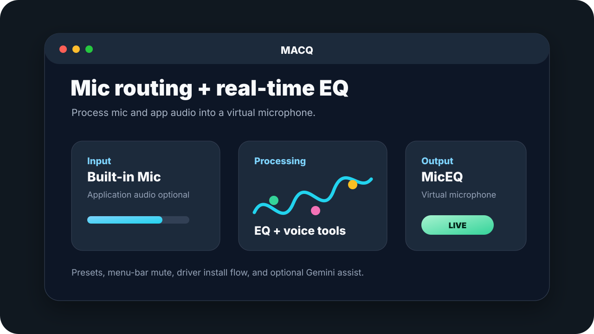
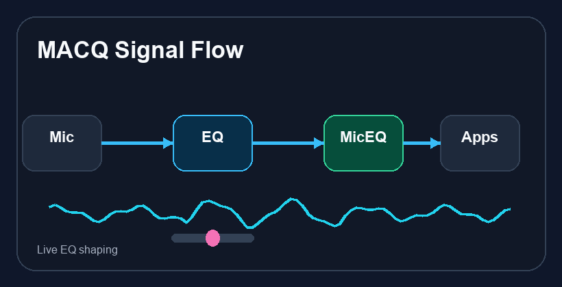
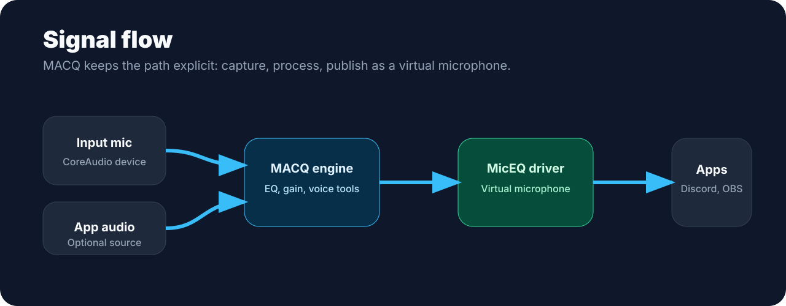

<p align="center">
  
</p>

<h1 align="center">MACQ</h1>

<p align="center">
  <strong>Vibe Coded Mic EQ, voice processing, app-audio routing, and a virtual microphone for macOS.</strong>
</p>

<p align="center">
  
  
  
  
</p>

> The folder is named `MACEQ`, but the app, bundle, and Swift package product are named `MACQ`.

## Demo

<p align="center">
  
</p>

MACQ turns a selected microphone or application-audio source into a processed virtual microphone. The app builds and bundles a CoreAudio HAL driver named **MicEQ**, then routes processed audio into that driver so apps like Discord, OBS, or recording tools can select it as a microphone input.

## Signal Flow

<p align="center">
  
</p>

## Features

| Category | Capability |
| --- | --- |
| Routing | Select input devices, optional app-audio capture, and monitor output. |
| Processing | Real-time EQ and voice-tool controls with smoothed updates. |
| Virtual mic | Installs and manages the `MicEQ.driver` CoreAudio HAL device. |
| Presets | Save, rename, import, and export `.macqeq` preset files. |
| Menu bar | Quick mute, processing toggle, device refresh, and audio restart controls. |
| AI assist | Optional Gemini preset suggestions with API keys stored in macOS Keychain. |

## Requirements

- macOS 13 or later
- Xcode Command Line Tools or Xcode
- CMake
- Admin permission for installing or removing the HAL driver
- Recursive submodule checkout for `ThirdParty/libASPL`

## Quick Start

```bash
git clone --recurse-submodules <your-repo-url>
cd MACEQ
./script/build_and_run.sh --verify
```

Normal launch:

```bash
./script/build_and_run.sh
```

Logs:

```bash
./script/build_and_run.sh --logs
```

If you cloned without submodules:

```bash
git submodule update --init --recursive
```

## Driver Notes

The driver source lives in `MicEQDriver/` and builds into:

```text
MicEQDriver/build/MicEQ.driver
```

At runtime, the app can install the driver into:

```text
/Library/Audio/Plug-Ins/HAL/MicEQ.driver
```

Installing or removing the driver restarts CoreAudio and may require admin approval.

## Project Layout

```text
.
├── Assets/                 # App icons, menu-bar art, and README visuals
├── MicEQDriver/            # CoreAudio HAL virtual microphone driver
├── Sources/MicEQ/          # SwiftUI app, services, models, DSP, views
├── ThirdParty/libASPL/     # AudioServerPlugIn helper library submodule
├── script/build_and_run.sh # Build, stage, sign, launch, verify
├── Package.swift           # SwiftPM app package
└── README.md
```

## Privacy

- Gemini API keys are stored in the user's macOS Keychain.
- Audio samples are only sent to Gemini when the user explicitly generates AI suggestions.
- Local build outputs are ignored and should not be committed.
- No `.env`, token, credential, or client secret files were found in the checked project area.

## Troubleshooting

| Problem | Fix |
| --- | --- |
| `MicEQ` device does not appear | Reinstall the driver from Settings or restart CoreAudio. |
| Microphone capture is blocked | Enable MACQ in System Settings -> Privacy & Security -> Microphone. |
| App-audio capture is blocked | Grant the requested system-audio/screen-capture permission. |
| Build cannot find `libASPL` | Run `git submodule update --init --recursive`. |
| Signing prompts repeat | Install an Apple Development signing identity or accept ad-hoc signing for local testing. |

<details>
<summary>Build script behavior</summary>

`script/build_and_run.sh` builds the HAL driver with CMake, builds the Swift app with SwiftPM, stages `dist/MACQ.app`, copies the driver and app artwork into the bundle, signs the bundle, then launches or verifies it.

Generated output is ignored:

- `.build/`
- `.swift-build/`
- `dist/`
- `MicEQDriver/build/`

</details>

## Upload Notes

This repo is close to publish-ready. Before making it public, choose a license and decide whether `ThirdParty/libASPL` should stay as a submodule or be vendored directly with its license files preserved.
